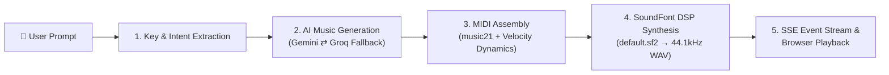

# 🎵 WaveSmith — AI Music Compositor

> Transform plain natural language prompts into expressive, multi-track MIDI compositions and synthesized 44.1kHz WAV audio in real-time.

[](https://fastapi.tiangolo.com)
[](https://nextjs.org)
[](https://langchain-ai.github.io/langgraph/)
[](https://www.python.org/)
[](https://www.typescriptlang.org/)
[](https://github.com/schellingb/tinysoundfont)

---

## ✨ Features

- **Natural Language to Music**: Describe musical visions in plain English (*e.g., "Create a melancholic, emotional violin melody in C minor with deep string chords"* or *"Fast energetic Krishna flute with acoustic guitar"*).
- **Resilient Dual-LLM Engine**:
  - **Primary**: Google Gemini (`gemini-3.1-flash-lite`) with structured output schema enforcement.
  - **Secondary (Zero-Downtime Fallback)**: Groq (`openai/gpt-oss-120b`) for instantaneous failover if Gemini hits 503 high-demand spikes or rate limits.
- **Full 128 General MIDI Palette**:
  - Supports the complete General MIDI instrument specification (Programs 0–127).
  - Handles lead melodies, multi-part counterpoint, polyphonic chord voicings, and pitched percussion (Taiko Drum, Synth Drum, Melodic Tom).
- **Intent-Aware Track Orchestration**:
  - **Solo Mode**: Detects requests for *"only flute"*, *"solo piano"*, or *"just drums"*, generating pure single-voice audio without unwanted background instruments.
  - **Dual-Track Matching**: Supports explicit requests like *"use violin in both melody and harmony tracks"*.
  - **Custom Accompaniments**: Intelligently pairs melody leads with style-appropriate harmonic voicings.
- **Ultra-Fast SoundFont Audio Synthesis**:
  - Uses `tinysoundfont` and `soundfonts/default.sf2` to render MIDI directly into high-fidelity 44.1kHz stereo WAV audio in under 1 second.
- **Real-Time Server-Sent Events (SSE)**:
  - Streams live pipeline status updates stage-by-stage to the browser, eliminating cold-wait latency.
- **Modern WaveSmith Studio UI**:
  - Next.js 14 App Router, Tailwind CSS, Lucide icons, glassmorphism cards, interactive playback controls, and visual piano-roll/score breakdown.

---

## 🏗️ Architecture & Pipeline



### Event Streaming Stages

1. `extracting_key`: Sanitizes prompt input and selects harmonic tonality.
2. `generating_notes`: AI agent drafts structured melody notes, chords, BPM, and meter.
3. `compiling_midi`: Builds `music21` multi-track stream, applies humanized dynamic velocity and measure accents.
4. `rendering_wav`: Synthesizes 44.1kHz WAV audio via TinySoundFont DSP engine.
5. `completed`: Delivers structured composition breakdown and download URLs.

---

## 📂 Project Structure

```text
ai-music-compositor/
├── app.py                     # Production FastAPI service with SSE endpoints
├── music.py                   # LangGraph state machine & LLM client failover setup
├── component.py               # 128 GM instrument resolver, composer agent & MIDI builder
├── audio_synth.py             # TinySoundFont 44.1kHz stereo WAV audio renderer
├── main.py                    # Interactive CLI runner
├── requirements.txt           # Python dependencies
├── .env                       # API credentials (Gemini, Groq)
├── soundfonts/
│   └── default.sf2            # General MIDI SoundFont bank (151MB)
├── storage/
│   └── compositions/          # Cache for generated .mid and .wav files
└── frontend/                  # Next.js 14 web client
    ├── src/
    │   ├── app/
    │   │   ├── page.tsx       # WaveSmith main studio dashboard
    │   │   └── layout.tsx     # Root layout with fonts and meta
    │   └── components/
    │       ├── AudioPlayer.tsx          # Real-time player with scrub bar & volume
    │       ├── CompositionDetailsCard.tsx # Visual melody & chord progression viewer
    │       └── PipelineStatus.tsx       # Live 5-stage progress indicator
    ├── package.json
    └── tailwind.config.ts
```

---

## 🚀 Getting Started

### Prerequisites

- **Python**: 3.10, 3.11, or 3.12
- **Node.js**: 18.x or 20.x
- **API Keys**:
  - [Google AI Studio Key](https://aistudio.google.com/) (`GOOGLE_API_KEY`)
  - [Groq Cloud Key](https://console.groq.com/) (`GROQ_API_KEY`)

---

### 1. Backend Setup

1. **Clone the repository**:
   ```bash
   git clone https://github.com/your-username/ai-music-compositor.git
   cd ai-music-compositor
   ```

2. **Create and activate a virtual environment**:
   ```bash
   # Windows
   python -m venv venv
   .\venv\Scripts\activate

   # macOS / Linux
   python3 -m venv venv
   source venv/bin/activate
   ```

3. **Install dependencies**:
   ```bash
   pip install -r requirements.txt
   ```

4. **Configure environment variables**:
   Create a `.env` file in the root directory:
   ```env
   GOOGLE_API_KEY=your_gemini_api_key_here
   GROQ_API_KEY=your_groq_api_key_here
   ```

5. **Ensure SoundFont is present**:
   Ensure `soundfonts/default.sf2` is located in the `soundfonts/` folder.

6. **Start the FastAPI backend server**:
   ```bash
   uvicorn app:app --reload --port 8000
   ```
   *The API will be available at `http://127.0.0.1:8000` (Swagger docs at `http://127.0.0.1:8000/docs`).*

---

### 2. Frontend Setup

1. **Navigate to the frontend directory**:
   ```bash
   cd frontend
   ```

2. **Install frontend packages**:
   ```bash
   npm install
   ```

3. **Start the Next.js development server**:
   ```bash
   npm run dev
   ```
   *Open [http://localhost:3000](http://localhost:3000) in your browser.*

---

## 📡 API Reference

### 1. SSE Real-Time Composition Stream
`GET /api/v1/compose/stream`

Yields Server-Sent Events as each pipeline step finishes.

**Query Parameters:**
| Parameter | Type | Required | Default | Description |
|---|---|---|---|---|
| `prompt` | string | Yes | — | Musical description (3–250 chars) |
| `style` | string | No | `"Romantic era"` | Musical aesthetic or genre |

**Example SSE Events:**
```text
event: extracting_key
data: {"stage": "extracting_key", "message": "Sanitizing input and preparing harmonic key palette..."}

event: generating_notes
data: {"stage": "generating_notes", "message": "AI composer writing melody, chords, tempo, and rhythm..."}

event: compiling_midi
data: {"stage": "compiling_midi", "message": "Assembling music21 score and applying humanized velocity dynamics..."}

event: rendering_wav
data: {"stage": "rendering_wav", "message": "Synthesizing 44.1kHz audio via FluidSynth / DSP engine..."}

event: completed
data: {
  "stage": "completed",
  "session_id": "c1f72d42-498c-4a39-9d7a-12903b418a09",
  "target_seconds": 12.0,
  "composition": {
    "tempo_bpm": 84,
    "time_signature": "4/4",
    "melody_instrument": "Violin",
    "harmony_instrument": "Violin",
    "melody": [{"pitch": "D5", "duration": 1.5}, ...],
    "harmony": [{"pitches": ["D3", "F#3", "A3"], "duration": 4.0}, ...]
  },
  "midi_download_url": "/api/v1/download/c1f72d42.../midi",
  "audio_stream_url": "/api/v1/download/c1f72d42.../audio"
}
```

### 2. File Downloads
- **Audio (WAV)**: `GET /api/v1/download/{session_id}/audio`
- **MIDI File**: `GET /api/v1/download/{session_id}/midi`

---

## 🎼 Prompt Examples to Try

| Style | Example Prompt | Track Result |
|---|---|---|
| **Classical Violin** | `"Create a melancholic, emotional violin melody in C minor with deep string chords"` | Lead: Violin · Accomp: String Ensemble 1 |
| **Dual Violin** | `"Create a violin melody in D minor also use violin in both harmony and melody tracks"` | Lead: Violin · Accomp: Violin |
| **Solo Flute** | `"Give me music of flute only for 15 seconds"` | Lead: Flute · Accomp: None (Solo) |
| **Devotional** | `"Create an intricate Krishna style flute melody in D major"` | Lead: Flute · Accomp: Nylon String Guitar |
| **Rhythmic Beat** | `"Give me just beat of drum for 10 seconds"` | Lead: Synth Drum · Accomp: None (Solo) |
| **Baroque** | `"Create a two-part counterpoint invention in D Dorian for harpsichord"` | Lead: Harpsichord · Accomp: Harpsichord |

---

## 🛠️ Tech Stack

- **Backend Framework**: [FastAPI](https://fastapi.tiangolo.com/) with asynchronous background tasks and streaming responses.
- **Agent Orchestration**: [LangGraph](https://langchain-ai.github.io/langgraph/) & [LangChain Core](https://python.langchain.com/).
- **Music Representation**: [music21](https://web.mit.edu/music21/) & [pretty_midi](https://github.com/craffel/pretty-midi).
- **Audio DSP**: [tinysoundfont](https://github.com/schellingb/tinysoundfont) & [soundfile](https://pysoundfile.readthedocs.io/).
- **Frontend**: [Next.js 14](https://nextjs.org/) (React 18, TypeScript, Tailwind CSS).
- **Icons & Styling**: [Lucide React](https://lucide.dev/), Glassmorphism design system.

---

## ☁️ Deployment Guide

### Deploying Backend to Render (Docker)
1. Connect your GitHub repository to [Render](https://render.com/).
2. Select **Web Service** and choose **Docker** environment (or let Render auto-detect `Dockerfile` / `render.yaml`).
3. Add Environment Variables in the Render dashboard:
   - `GOOGLE_API_KEY`: Your Gemini API key
   - `GROQ_API_KEY`: Your Groq API key
4. Render will automatically build the `Dockerfile` with all required system C libraries (`libsndfile1`, `fluidsynth`) and bind to the dynamic `$PORT`.
5. Note your deployed backend URL (e.g. `https://wavesmith-backend.onrender.com`).

### Deploying Frontend to Vercel
1. Import the repository in [Vercel](https://vercel.com/).
2. Set the **Root Directory** to `frontend`.
3. Add Environment Variable:
   - `NEXT_PUBLIC_BACKEND_URL`: `https://your-backend.onrender.com` (your Render service URL without trailing slash)
4. Click **Deploy**.

---

## 📄 License

This project is licensed under the [MIT License](LICENSE).

